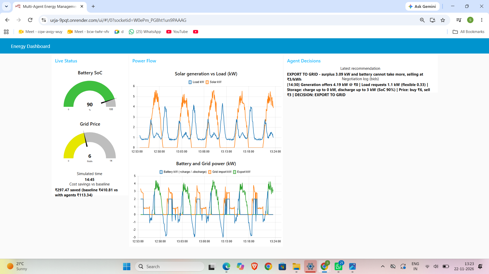
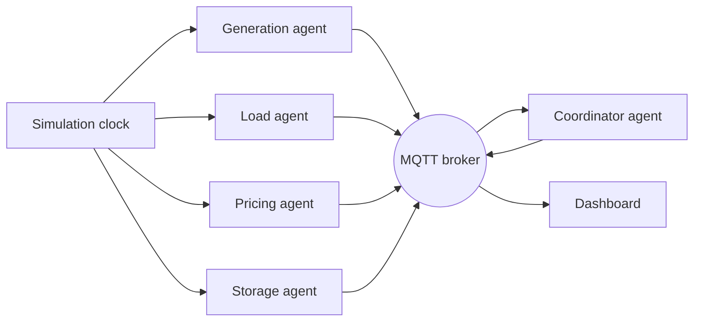
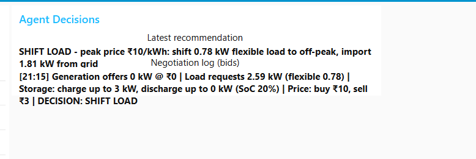

# Multi-Agent System for Energy Management Analysis

A multi-agent energy management system built with **MQTT** and **Node-RED**. Four agents (Generation, Load, Storage, Pricing) publish their state and bids over MQTT, and a **Coordinator agent** negotiates between them to recommend the cheapest energy action at every step: charge the battery, discharge it, export to the grid, shift load, or buy from the grid.

## Live demo

**Live dashboard:** https://urja-9pqt.onrender.com/ui

**Source code:** https://github.com/shreshthatajain/urja

> The dashboard is hosted on a free Render instance. If nobody has opened it for a while, the first load can take up to about a minute while the service wakes up. One simulated day takes about 6.5 minutes of real time.



## Problem statement

Renewable generation is variable, household and industrial demand has daily peaks, and grid electricity prices change through the day. Deciding when to store, use, sell or buy energy by hand is hard. This project shows how small autonomous agents can share information over a lightweight messaging protocol and reach a cost-saving decision together.

## System architecture



All agents communicate **only through MQTT topics**. The coordinator never reads another agent's variables directly, and the dashboard is driven entirely by the broker.

## The agents

| Agent | Role | Simulated behaviour |
|---|---|---|
| Generation | Publishes solar output and a supply bid | 5 kW peak at noon, zero at night, random cloud noise |
| Load | Publishes demand and a flexible-load bid | Morning and evening peaks, 30% of load is shiftable |
| Pricing | Publishes buy and sell tariffs | Rs 4 night, Rs 6 day, Rs 10 evening peak (18:00 to 22:00), random +Rs 3 spikes, Rs 3 export rate |
| Storage | Holds battery state and enforces limits | 10 kWh battery, 20 to 90% SoC window, 3 kW max rate, 95% efficiency |
| Coordinator | Negotiates and decides | Rule-based, runs 2 seconds after each tick once all bids have arrived |

## MQTT topics

Every topic starts with a prefix (`shreshthata/energy/` in this repo). Change it in `flows.json` if you want your own.

| Topic (after the prefix) | Published by | Content |
|---|---|---|
| `clock/hour` | Clock | Simulated hour of day |
| `generation/solar_kw` | Generation | Solar power in kW |
| `generation/bid` | Generation | Supply offered and its cost |
| `load/demand_kw` | Load | Demand in kW |
| `load/bid` | Load | Demand and flexible portion |
| `pricing/rate_per_kwh` | Pricing | Buy price in Rs/kWh |
| `pricing/export_rate` | Pricing | Sell price in Rs/kWh |
| `pricing/bid` | Pricing | Buy, sell and spike flag |
| `storage/soc_percent` | Storage | Battery state of charge |
| `storage/bid` | Storage | Maximum charge and discharge power available |
| `agent/command` | Coordinator | Battery, grid import, export and shifted load in kW |
| `agent/recommendation` | Coordinator | Plain-English decision |
| `agent/negotiation_log` | Coordinator | Summary of all bids and the decision |
| `agent/savings` | Coordinator | Cumulative cost saved against a baseline |

## Negotiation logic

Net power = solar generation minus load.

| Situation | Decision |
|---|---|
| Surplus, battery has room | Charge the battery with the surplus, export the rest |
| Surplus, battery cannot take more | Export to the grid |
| Deficit, price at or above Rs 8 (peak) | Shift flexible load, discharge the battery, import only the remainder |
| Deficit, price at or below Rs 4.5 (cheap) | Import from the grid, and charge the battery from the grid if SoC is under 70% |
| Deficit, normal price | Discharge the battery if SoC is above 50%, otherwise import |

**Savings** are measured against a baseline that has solar panels but no battery and no coordination. Shifted load is charged at the cheap tariff to account for when it is eventually consumed.

## Dashboard

Built with Node-RED Dashboard: battery SoC gauge, grid price gauge, simulated time, solar vs load chart, battery and grid power chart, latest recommendation, negotiation log with the bids, and the running cost savings.



## Tech stack

- **Node-RED** for the agents, coordinator and dashboard
- **MQTT** with the public HiveMQ broker (`broker.hivemq.com:1883`)
- **node-red-dashboard** for the user interface
- **Docker** and **Render** for hosting
- **GitHub** for version control

## Repository structure

```
.
├── Dockerfile      # builds the hosted Node-RED instance
├── package.json    # Node-RED and dashboard dependencies
├── settings.js     # read-only public settings (editor disabled)
├── flows.json      # the complete multi-agent flow and dashboard
├── docs/           # screenshots
└── README.md
```

## Run it locally

1. Install Node.js (LTS) from nodejs.org.
2. Install Node-RED: `npm install -g node-red`
3. Start it: `node-red`, then open http://localhost:1880
4. In the menu choose **Manage palette**, then **Install**, and add `node-red-dashboard`.
5. Choose **Import**, select `flows.json`, and click **Deploy**.
6. Open http://localhost:1880/ui
## Testing and validation

| # | Scenario | Input (from the negotiation log) | Expected | Observed | Result |
|---|---|---|---|---|---|
| 1 | Midday surplus, battery full | Solar 4.5 kW, load 1.23 kW, SoC 90%, price Rs 6 | Export the surplus | Export to grid, 3.27 kW | PASS |
| 2 | Evening peak, battery at minimum | No solar, load 2.59 kW (0.78 flexible), SoC 20%, price Rs 10 | Shift load, import the rest | Shift 0.78 kW, import 1.81 kW | PASS |
| 3 | Night, cheap tariff | No solar, load 0.74 kW, SoC 70%, price Rs 4 | Import from the grid | Import 0.74 kW | PASS |
| 4 | Battery limits respected | Gauge over several simulated days | SoC stays within 20 to 90% | Gauge reached 90 and 20, never outside | PASS |
| 5 | Agents communicate only via MQTT | Dashboard fed from broker topics | All panels update | All panels update | PASS |
| 6 | Battery discharge at peak price (SoC above 20%) | Evening, price Rs 10 | Discharge battery | Screenshot to be captured | PENDING |
| 7 | Grid charging at cheap tariff (SoC below 70%) | Night, price Rs 4 | Charge from grid | Screenshot to be captured | PENDING |
| 8 | Public link opens from another network | Phone on mobile data | Dashboard loads | To be confirmed | PENDING |
## Limitations and future work

- All data is **simulated**. Real sensors, for example an ESP32 reading solar voltage and current, could replace the generation and load agents without changing the coordinator.
- The coordinator uses **fixed rules and price thresholds**. It does not forecast. Adding load and solar forecasting or optimisation would improve the decisions.
- The public MQTT broker is open to anyone and is used here for demonstration. A private, authenticated broker with TLS should be used in a real deployment.
- An LLM could be added to explain each decision in natural language.
- Battery degradation and the battery's starting charge are not included in the savings calculation.

## Author

Shreshthata Jain
